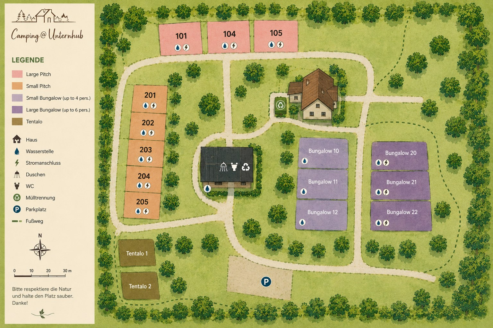

====================
Camping Map Booking
====================

..
   !! This file is manually kept in sync with the readme/*.md fragments. !!
   !! Update the fragment, then mirror the change here.                 !!

Interactive campsite map with clickable areas linking to rentable pitches.

**Table of contents**

.. contents::
   :local:

Description
===========

Turns a plain campsite photo or site plan into an interactive booking map.

Draw clickable zones over your own map image, link each one to the pitches
(``product.template`` / ``resource.resource`` records) it contains, and the
zones color themselves live: **free**, **occupied**, or **not suitable**
for the visitor's vehicle - computed straight from existing
``planning.slot`` bookings for the dates and vehicle type they're checking.

The same map component powers two places:

- **Website checkout** - shown during pitch selection in the booking flow
  (``website_sale_renting``), so guests pick a pitch by clicking it on the
  map instead of scrolling a list.
- **Backend preview** - the ``campsite.map`` record's "Map Preview" and
  "Testing" tabs let staff calibrate zones and simulate a stay/vehicle to
  see exactly what guests will see before it goes live.

Requires Odoo **Enterprise** (the Rental app: ``sale_renting`` /
``website_sale_renting``).

Configuration
=============

Replace ``static/src/img/camping_map.png`` with the site's actual map image,
then recalibrate each ``camping.map.zone``'s ``points`` field to match its
pixel dimensions - the demo zones ship with placeholder rectangles and need
to be redrawn by eye against the real image (open a ``campsite.map``
record's "Map Preview" or "Testing" tab in the backend, compare the overlay
to the photo, and adjust the polygon coordinates accordingly).

Usage
=====

#. Go to **Camping Maps** and open (or create) a ``campsite.map`` record.
#. Upload the site image and use **Create Zone for Each Resource** on the
   "Zones" tab to generate one zone per material ``resource.resource``
   (existing pitches/bungalows), or add zones by hand.
#. For each zone, draw its outline by setting ``points`` to the polygon's
   pixel coordinates on the image (``"x1,y1 x2,y2 x3,y3 ..."``), and pick
   an optional icon (tent, water, electricity, ...).
#. Check the result on the "Map Preview" tab. Use the "Testing" tab to pick
   a stay and a vehicle type and confirm the free/occupied/not-suitable
   colors match what's actually booked.
#. Restrict which vehicles a pitch suits by setting **Allowed Vehicles** on
   its ``planning.role`` (leave empty to allow any vehicle).
#. Publish the pitches as rentable products; the map then appears
   automatically during pitch selection at website checkout.

Availability labels and colors are themselves editable records
(``camping.map.state``), and vehicle types (``camping.vehicle.type``) can be
extended to match your fleet.

Bug Tracker
===========

Bugs and feature requests should be reported to mytime.click at
https://mytime.click.

Credits
=======

Authors
-------

* mytime.click

Maintainers
-----------

This module is maintained by mytime.click.
